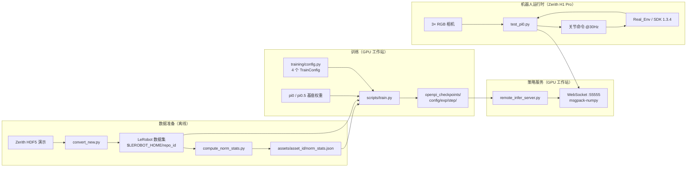
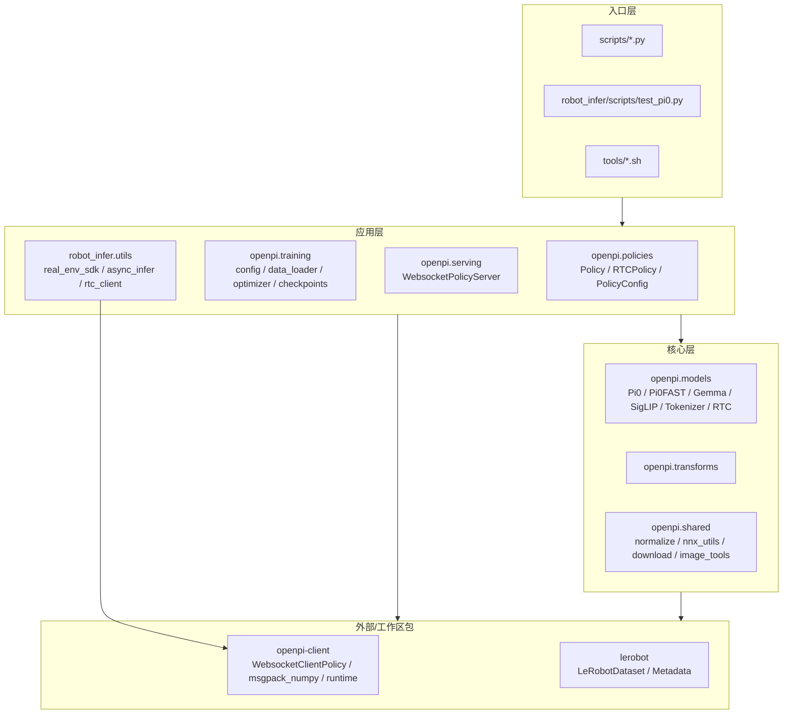
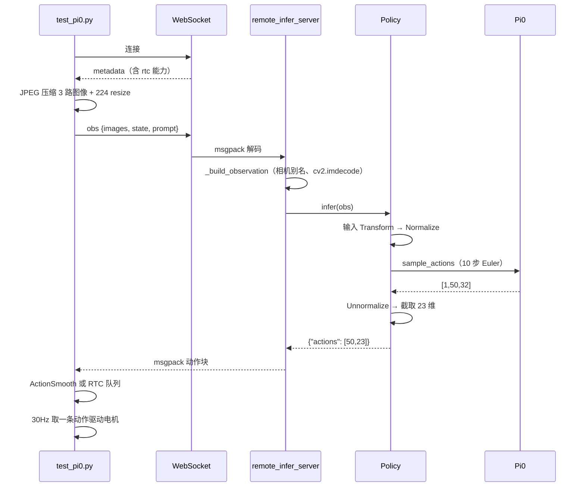
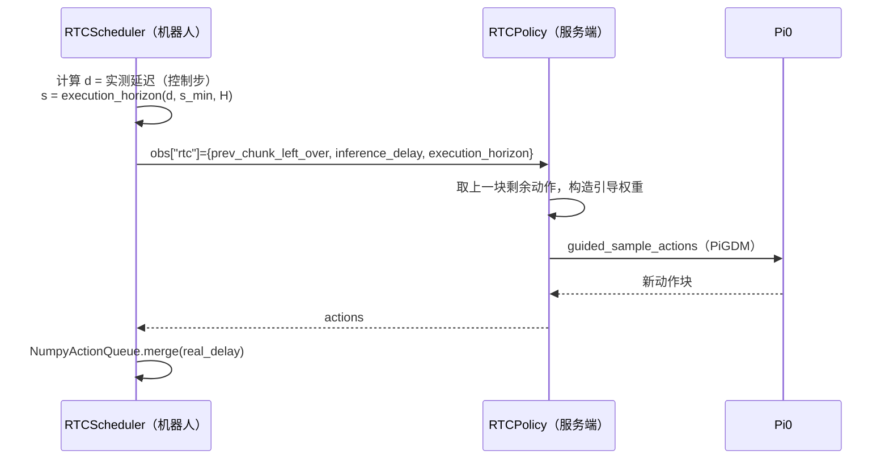

# 02 系统架构

## 1. 总体架构

系统由三个物理角色组成，通过文件系统与 WebSocket 解耦：



### 关键解耦点

| 边界 | 协议/格式 | 说明 |
| --- | --- | --- |
| 数据 → 训练 | LeRobot 数据集 + `norm_stats.json` | 数据集与统计分目录存放，路径由 `repo_id` / `asset_id` 决定 |
| 训练 → 服务 | Orbax Checkpoint | Checkpoint 内含 `params/` 与 `assets/<asset_id>/norm_stats.json`，服务端只依赖该目录 |
| 服务 ↔ 机器人 | WebSocket + msgpack-numpy | 首帧回传 metadata，之后一问一答；图像在机器人端压缩为 JPEG |
| 机器人 → 硬件 | Zerith SDK（`robot_infer/lib`） | 21 个电机（16 臂 + 3 腰 + 2 头），底盘 2 维不执行 |

## 2. 模块分层



### 模块职责

| 层 | 模块 | 职责 |
| --- | --- | --- |
| 入口 | `scripts/` | 数据转换、统计、训练、服务、评估、数据体检 |
| 入口 | `robot_infer/scripts/` | 机器人主控制循环与 CLI |
| 应用 | `openpi/policies/` | 把模型包装成 `infer(obs)->dict` 的策略；组装输入/输出 Transform、RTC、子任务阶段 |
| 应用 | `openpi/training/` | `TrainConfig` 定义、数据加载、优化器、权重加载、分片、Checkpoint |
| 应用 | `openpi/serving/` | 通用 WebSocket 服务端（部署使用 `remote_infer_server.py` 中的增强版） |
| 应用 | `robot_infer/utils/` | SDK 环境封装、后台推理线程、RTC 调度、Home 守卫 |
| 核心 | `openpi/models/` | Pi0/Pi0.5/FAST 网络、Gemma、SigLIP、ViT、LoRA、Tokenizer、RTC 引导函数 |
| 核心 | `openpi/transforms.py` | 可组合的数据变换原语 |
| 核心 | `openpi/shared/` | 归一化统计、NNX 工具、下载、图像工具、数组类型约束 |
| 外部 | `packages/openpi-client` | 客户端策略、msgpack-numpy 编解码、action chunk broker、runtime 抽象 |
| 外部 | `packages/lerobot` | LeRobot 数据集读写与元数据 |

## 3. 训练侧数据流

```mermaid
flowchart LR
    A["LeRobot Dataset<br/>observation.images.* / observation.state / action / task"] --> B["RepackTransformWithFallback"]
    B --> C["MobilearxInputs<br/>图像 CHW→HWC, uint8<br/>state pad 到 32"]
    C --> D["DeltaActions<br/>7,-1,7,-1,5,-2"]
    D --> E["ZeroDims(21,22)"]
    E --> F["Normalize<br/>z-score 或 quantile"]
    F --> G["InjectDefaultPrompt"]
    G --> H["ResizeImages(224,224)"]
    H --> I["TokenizePrompt /<br/>TokenizePi05SubtaskInputs"]
    I --> J["PadStatesAndActions(32)"]
    J --> K["Pi0.compute_loss<br/>flow matching + 子任务 CE"]
```



输出侧（推理）顺序相反：

```text
model.sample_actions
  → Unnormalize
  → ZeroDims(21,22)
  → AbsoluteActions(delta mask)
  → MobilearxOutputs（截取前 23 维）
```

动作布局与 delta 规则详见 [03 数据管线](./03-data-pipeline.md)。

## 4. 推理请求生命周期

### 4.1 普通路径（无 RTC）



### 4.2 子任务路径（pi0.5）

| 模式 | 行为 | 延迟 |
| --- | --- | --- |
| `none` / `off` | 直接生成动作，不预测子任务 | 最低 |
| `classifier`（默认） | 一次 prefix 前向 + 分类头 → 查表得到子任务文本 → 重建 prompt → 生成动作 | 中 |
| `generate` | 自回归解码子任务 token → 重建 prompt → 生成动作 | 高（每 token 一次 2B 前向） |

分类头模式仍会把预测文本附加到响应 `result["subtask"]`，供机器人端做阶段日志与 Home 守卫。

### 4.3 RTC 路径



协议字段与调度细节见 [06 策略服务](./06-serving-and-client.md) 与 [07 机器人运行时](./07-robot-runtime.md)。

## 5. 部署拓扑

```text
┌─────────────────────────────┐          ┌──────────────────────────────┐
│ GPU 工作站                   │          │ Zerith H1 Pro 机器人          │
│                             │  Wi-Fi/  │                              │
│  remote_infer_server.py     │  以太网  │  test_pi0.py                 │
│   - JAX/Flax Pi0 模型        │◄────────►│   - 相机采集 + JPEG          │
│   - RTC / 子任务             │  55555   │   - ActionSmooth / RTC       │
│   - msgpack-numpy            │          │   - Real_Env → SDK           │
└─────────────────────────────┘          └──────────────────────────────┘
         │                                           │
         └── 读取 Checkpoint / norm_stats             └── 仅需 robot_infer/ + openpi-client
```

- 服务端监听 `0.0.0.0:<port>`，默认 `55555`。
- 机器人端不加载模型，只运行轻量客户端；因此机器人环境无需安装 JAX/CUDA。
- 训练、服务、评估可共用一台 GPU 工作站，但评估脚本通常被安排到另一张 GPU（`CUDA_VISIBLE_DEVICES`）。

## 6. 路径与命名约定

| 内容 | 规则 | 示例 |
| --- | --- | --- |
| LeRobot 数据集 | `$LEROBOT_HOME/<repo_id>` | `/data/4T-2/dataset/hewu2008/part_sorting_20261027_subtask` |
| 归一化统计 | `<assets_base_dir>/<asset_id>/norm_stats.json` | `./assets/hewu2008/part_sorting_20261027_clean/norm_stats.json` |
| Checkpoint | `<checkpoint_base_dir>/<config.name>/<exp_name>/<step>/` | `./openpi_checkpoints/pi05_zerith_subtask_cls/part_sorting_.../15999/` |
| Checkpoint 内部 | `params/`、`assets/<asset_id>/norm_stats.json`、`train_state/`、`wandb_id.txt` | 服务端从 `params/` 与 `assets/` 读取 |
| 子任务类别表 | `<dataset>/meta/subtasks.jsonl` 或 `assets/subtasks.jsonl` | 13 行，`subtask_index` 从 0 连续 |

## 7. 关键设计决策

1. **23 维物理动作 → 32 维模型动作**：`MobilearxInputs` 用 `pad_to_dim` 补齐，输出时截取前 23 维；unused 维度不参与机器人执行。
2. **部分维度使用 delta 动作**：手臂/腰/头用相对当前状态的增量（`DeltaActions`），夹爪与底盘保持绝对值；底盘 2 维被 `ZeroDims` 置零（机器人端不执行）。
3. **三路相机固定语义**：`cam_high → base_0_rgb`、`cam_left_wrist → left_wrist_0_rgb`、`cam_right_wrist → right_wrist_0_rgb`；服务端兼容 `rs/`、`rs.`、`rs_` 和嵌套 `rs` 字典。
4. **图像两段式尺寸**：数据集保存 `640×480`；训练/推理 Transform 统一 `resize_with_pad` 到 `224×224`；机器人传输前再 JPEG 压缩。
5. **服务端无状态、机器人端有状态**：RTC 的块合并、延迟统计、动作平滑都在机器人端完成；服务端只做单次带引导的采样。
6. **LoRA + 冻结基座**：`freeze_filter` 冻结 PaliGemma LLM（`.*llm.*`，排除 action expert `.*llm.*_1.*`），LoRA 参数保持可训练；pi0.5 基座无 LoRA 权重时由 `CheckpointWeightLoader` 回填初始化值。
7. **子任务分类器热启动**：分类头是随机初始化的，因此使用 `AdamWGroupedLR` 给分类头 100× 学习率，并在权重加载时用 `missing_regex=".*lora.*|.*subtask_classifier.*"` 允许其保留新初始化。

---

下一步：[03 数据管线](./03-data-pipeline.md)
