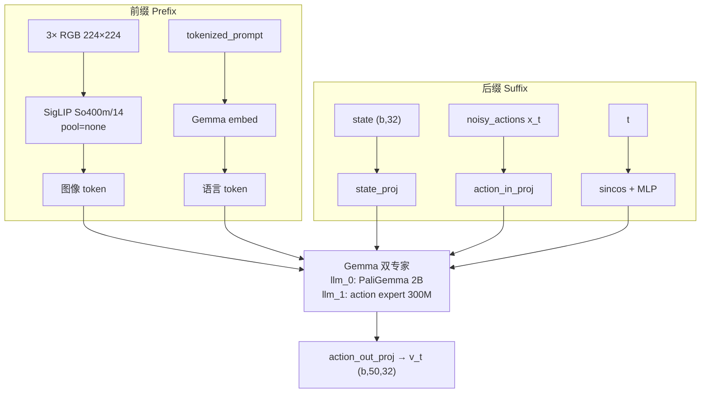

# 04 模型体系

模型层位于 [src/openpi/models/](../../src/openpi/models/)，使用 **JAX + Flax NNX** 实现。核心是 pi0 / pi0.5 的「PaliGemma 前缀 VLM + action expert 后缀」双专家结构，并在此基础上提供 LoRA、子任务预测、RTC 引导采样与 FAST 离散动作变体。

---

## 1. 模型输入/输出契约

文件：[model.py](../../src/openpi/models/model.py)

```python
class ModelType(enum.Enum):
    PI0 = "pi0"
    PI0_FAST = "pi0_fast"
    PI05 = "pi05"

IMAGE_KEYS = ("base_0_rgb", "left_wrist_0_rgb", "right_wrist_0_rgb")
IMAGE_RESOLUTION = (224, 224)
```

`Observation`（struct.dataclass）：

| 字段 | 形状/类型 | 含义 |
| --- | --- | --- |
| `images` | `dict[str, [*b, h, w, c]]` | RGB 图像，取值 `[-1, 1]` 或 `[0, 255]` |
| `image_masks` | `dict[str, bool[*b]]` | 图像有效性掩码，键与 `images` 一致 |
| `state` | `float32[*b, s]` | 低维本体状态（Zerith 补齐到 32） |
| `tokenized_prompt` | `int32[*b, l]` | 语言 prompt token，可空 |
| `tokenized_prompt_mask` | `bool[*b, l]` | prompt 有效 token 掩码 |
| `token_ar_mask` | `int32[*b, l]` | 自回归掩码（FAST / 子任务生成） |
| `token_loss_mask` | `bool[*b, l]` | 子任务 token 的损失掩码 |
| `subtask_class` | `int32[*b]` | 子任务类别标签（-1 表示无标注） |

`Actions = float32[*b, ah, ad]`，其中 `ah = action_horizon`（Zerith 为 50），`ad = action_dim`（32）。

`Observation.from_dict()` 把 Transform 产出的扁平字典转成该结构；`BaseModelConfig` 提供：

- `create(rng)`：初始化模型；
- `load(params, remove_extra_params=True)`：加载参数（形状/结构严格校验）；
- `inputs_spec(batch_size)`：JAX `ShapeDtypeStruct` 规格；
- `fake_obs` / `fake_act`：生成占位输入；
- `model_type`、`get_freeze_filter()`。

`BaseModel` 要求实现 `compute_loss` 与 `sample_actions`；pi0.5 还额外实现 `compute_loss_terms`、`predict_subtask_class`、`guided_sample_actions` 等。

---

## 2. Pi0Config

文件：[pi0_config.py](../../src/openpi/models/pi0_config.py)

| 字段 | 默认值 | 说明 |
| --- | --- | --- |
| `dtype` | `"bfloat16"` | 模型计算精度 |
| `paligemma_variant` | `"gemma_2b"` | 前缀 LLM 变体（Zerith 用 `gemma_2b_lora`） |
| `action_expert_variant` | `"gemma_300m"` | action expert 变体 |
| `action_dim` | `32` | 模型动作维度（> 机器人 23 维） |
| `action_horizon` | `50` | 单次预测动作步数 |
| `max_token_len` | `None → 200 (pi05) / 48` | prompt 最大 token 数 |
| `pi05` | `False` | 是否 pi0.5（状态离散化 + adaRMS） |
| `discrete_state_input` | `None → pi05` | 状态是否进入语言 token |
| `train_subtask_prediction` | `False` | 训练时是否加子任务 token 交叉熵 |
| `sample_subtask_prediction` | `False` | 推理时是否两阶段（先生成子任务） |
| `subtask_loss_weight` | `1.0` | 子任务 CE 权重（Zerith 配置为 0.1） |
| `max_subtask_len` | `20` | 子任务保留槽位数（Zerith 为 30） |
| `subtask_temperature` | `0.0` | 0 = 贪心；>0 按 `logits/τ` 采样 |
| `subtask_classification` | `False` | 是否使用分类头替代自回归生成 |
| `num_subtask_classes` | `0` | 分类类别数（Zerith 为 13） |
| `subtask_class_loss_weight` | `0.2` | 分类 CE 权重 |

`__post_init__` 会校验：分类头必须搭配 `pi05=True` 且 `train_subtask_prediction=True`，并且 `num_subtask_classes > 0`。

`get_freeze_filter()` 的逻辑：

```text
若 paligemma_variant 含 lora：
    冻结 .*llm.*（并排除 action expert 的 .*llm.*_1.*，除非 action expert 也用 lora）
若任一专家用 lora：
    排除 .*lora.*（即 LoRA 参数保持可训练）
```

---

## 3. Pi0 网络结构

文件：[pi0.py](../../src/openpi/models/pi0.py)



### 3.1 初始化要点

- `PaliGemma` 是 `nnx.Dict(llm=..., img=...)`。
- `llm` 使用 `nnx_bridge.ToNNX` 包装旧式 Flax `_gemma.Module`，传入两个 config：`[paligemma_config, action_expert_config]`。
- `pi05=True` 时 `adarms=True`，`use_adarms=[False, True]`。
- `img` 固定 `SigLIP So400m/14`，`num_classes=paligemma_config.width`，`pool_type="none"`。
- 投影层：
  - `action_in_proj: action_dim → action_expert.width`
  - pi0：`state_proj`、`action_time_mlp_in/out`（时间与动作拼接后过 MLP）
  - pi0.5：`time_mlp_in/out`（时间 embedding 作为 adaRMS 条件）
  - `action_out_proj: action_expert.width → action_dim`
- `subtask_classification=True` 时增加 `SubtaskClassifier(width, hidden=512, num_classes)`，fp32。

### 3.2 `embed_prefix`

1. 每个相机图像过 `PaliGemma.img`，得到图像 token；`image_masks` 广播成 token 级 mask；图像 token 之间全注意力（AR mask = 0）。
2. `tokenized_prompt` 过 `PaliGemma.llm(..., method="embed")`；若有 `token_ar_mask`（子任务生成），语言 token 按因果掩码。
3. 返回 `tokens, input_mask, ar_mask`。

### 3.3 `embed_suffix`

- pi0：
  - 状态投影成 1 个 state token，`ar_mask=1`（前缀不能看状态/动作）。
  - 动作 token + 时间 token 拼接后过 `action_time_mlp`。
- pi0.5：
  - 状态已在 prompt 中，不额外加 state token。
  - 时间 embedding 过 `time_mlp`，作为 **adaRMS 条件**（`adarms_cond`）。
  - 动作 token 直接进入 action expert。
- 后缀的 AR mask 是 `[True, False, ..., False]`：动作 token 之间因果（第 1 个动作看得到自己，其余递推）。

### 3.4 注意力

`make_attn_mask(input_mask, mask_ar)` 构造二维注意力掩码：

- `mask_ar=False` 的 token 可以看前面所有有效 token；
- `mask_ar=True` 的 token 只能看前面（因果）。
- 前缀（图像 + 语言）默认全注意力；后缀动作 token 因果。

`positions = cumsum(input_mask) - 1`，供 RoPE 使用。

---

## 4. Flow Matching 训练与采样

### 4.1 损失

`compute_loss_terms`：

```text
t ~ Beta(1.5, 1) * 0.999 + 0.001
x_t = t * noise + (1 - t) * actions
u_t = noise - actions
v_t = model(images, prompt, state, x_t, t)
action_loss = mean((v_t - u_t)^2, axis=-1)   # [b, ah]
```

- 一次前向同时跑前缀与后缀（`mask` 拼接），无需两阶段。
- `time` 越大越接近噪声：`t=1` 噪声，`t=0` 目标。
- 若开启子任务预测，额外返回：
  - `subtask_ce`：子任务 token 的交叉熵；
  - `class_ce`：子任务分类头的交叉熵（未开启则为 0）。

### 4.2 `sample_actions`

```text
dt = -1/num_steps
x_t = noise
先对 prefix 做一次前向，得到 KV cache
for step in range(num_steps):        # 默认 10
    v_t = suffix_velocity(x_t, t)    # 只用 KV cache 跑后缀
    x_t = x_t + dt * v_t
    t += dt
return x_t
```

- 前缀只算一次，显著降低推理成本。
- `num_steps` 是静态参数，进入 JIT 图。

---

## 5. 子任务预测（pi0.5 高层阶段）

### 5.1 训练

- `subtask_lm_loss`：取 `prefix_out` 中 prompt 部分，左移一位预测下一个 token；用 `token_loss_mask` 只监督子任务 token，未标注帧 loss 为 0。
- `subtask_class_loss`：对 `_subtask_cue_hidden`（`Subtask: ` 前的最后一个前缀隐状态）过分类头，`subtask_class >= 0` 的样本才有 loss。
- `train.py` 中：`total = flow + α * ce + β * cls`，默认 `α=0.1`、`β=0.2`（由配置决定）。

### 5.2 推理

| 方法 | 行为 |
| --- | --- |
| `sample_subtask(rng, observation, temperature)` | 固定 `max_subtask_len` 个槽位，前缀 KV cache 预填充后 `lax.while_loop` 逐 token 解码，遇到 EOS 提前停止；返回带有子任务文本的 observation、token 与 mask |
| `predict_subtask_class(observation)` | 一次前缀前向 + 分类头 argmax，无自回归解码；返回类别 id |
| `subtask_class_logits` | 分类头 fp32 前向 |
| `_subtask_cue_hidden` | 取 `Subtask: ` 尾部的隐状态作为分类特征 |

`Policy._run_subtask_stage` 负责把类别 id 映射成文本，或把生成 token detokenize，然后用该文本重建模型输入，再执行 `sample_actions`。

---

## 6. RTC（Real-Time Chunking）模型层

文件：[rtc.py](../../src/openpi/models/rtc.py)

| 函数 | 作用 |
| --- | --- |
| `rtc_weights(d, s, horizon, prev_len)` | 论文三段式权重：`i<d` 为 1；`d≤i<H-s` 按 `c·expm1(c)/(e-1)`；`i≥H-s` 为 0 |
| `guidance_scale(time, beta)` | 随去噪时间变化的引导强度 |
| `RTC_PROTOCOL_VERSION = 1` | 客户端/服务端协议版本 |

`Pi0.guided_sample_actions(rng, observation, prev_actions, weights, beta=10, num_steps=10, guidance_steps=None)`：

1. 前缀 KV cache 只算一次；
2. 每个去噪步：
   - `v_t = suffix_velocity(x_t, t)`；
   - 前 `guidance_steps` 步用 `jax.vjp` 计算精确 VJP 修正 `(I - t·dv/dx)^T · err`；
   - 其余步退化为 `correction = err`（identity 近似，无反向开销）；
   - `v_guided = v_t - guidance_scale(t, β) · correction`；
   - Euler 更新。
3. `weights` 为 `(H,)`，客户端与服务端各自实现同一公式，并有交叉测试防漂移。

> `guided_sample_actions` 的 `beta` 必须是 Python float（`@at.typecheck` 拒绝 traced scalar），因此 `RTCPolicy` 在 jit 时把 `beta` 放入 `static_argnames`。

---

## 7. Gemma / LoRA / SigLIP

### 7.1 Gemma 变体

文件：[gemma.py](../../src/openpi/models/gemma.py)、[gemma_fast.py](../../src/openpi/models/gemma_fast.py)

| 变体 | width | depth | mlp | heads | kv heads | head_dim | LoRA |
| --- | --- | --- | --- | --- | --- | --- | --- |
| `dummy` | 64 | 4 | 128 | 8 | 1 | 16 | — |
| `gemma_300m` | 1024 | 18 | 4096 | 8 | 1 | 256 | — |
| `gemma_300m_lora` | 1024 | 18 | 4096 | 8 | 1 | 256 | rank 32, α 32 |
| `gemma_2b` | 2048 | 18 | 16384 | 8 | 1 | 256 | — |
| `gemma_2b_lora` | 2048 | 18 | 16384 | 8 | 1 | 256 | rank 16, α 16 |

- `Module` 支持传入多个 config，实现 **多专家**（`llm_0` 前缀、`llm_1` action expert）。
- `RMSNorm` 在 pi0.5 中接受 `cond`，即 **adaRMSNorm**。
- 注意力使用固定大小 KV cache（训练时长度 0，推理时逐步 overwrite）。
- `gemma_fast.py` 是 FAST 专用实现，`scan=True`、`remat_policy="nothing_saveable"`，vocab 257,152。

### 7.2 LoRA

文件：[lora.py](../../src/openpi/models/lora.py)

- `LoRAConfig(rank, alpha=1.0, rslora=False)`；缩放因子为 `alpha/rank`（或 rank-stabilized 的 `alpha/sqrt(rank)`）。
- 在 `Einsum` 与 `FeedForward` 中插入 `*_lora_a` / `*_lora_b` 参数：
  - `gating_einsum_lora_a/b`
  - `linear_lora_a/b`
- `get_freeze_filter()` 冻结基座 LLM，但排除 `.*lora.*`，因此 LoRA 与 action expert 可训练。

### 7.3 SigLIP

文件：[siglip.py](../../src/openpi/models/siglip.py)

- 变体：`So400m/14`（width 1152、depth 27、MLP 4304、16 heads）。
- `pool_type="none"`：返回全部 patch token（供 LLM 前缀使用），不池化。
- `Module(num_classes=width, variant, pool_type, scan, dtype_mm)` 是工厂函数。

---

## 8. Tokenizer

文件：[tokenizer.py](../../src/openpi/models/tokenizer.py)

### 8.1 `PaligemmaTokenizer`

- `tokenize(prompt, state=None)`：
  - pi0：`"Task: {prompt}, State: {离散化状态};\nAction: "`（状态作为连续输入时不拼入文本）。
  - pi0.5：`"Task: {prompt}, State: {state};\nAction: "`，状态被离散成固定宽度的数字 token。
  - 子任务训练：`"Task: ..., State: ...;\nSubtask: {label};\nAction: "`。
  - 子任务生成：在 `Subtask: ` 后预留 `max_subtask_len` 个 masked 槽位，再放 `\nAction: `。
- `tokenize` 返回 `(tokens, mask)`，并处理 EOS 与 padding。
- `detokenize(tokens, mask)`：把生成的子任务 token 还原成文本（会去掉尾部 `;` 等）。

### 8.2 `FASTTokenizer`

- 把动作离散成 FAST token，并映射到 PaliGemma 词表；
- 输出 `tokenized_actions`、`token_ar_mask`、`token_loss_mask`；
- 推理时 `ExtractFASTActions` 把生成 token 反解成连续动作。

---

## 9. Pi0-FAST（离散动作变体）

文件：[pi0_fast.py](../../src/openpi/models/pi0_fast.py)

- `Pi0FASTConfig`：`max_token_len=250`、`action_horizon=32`，使用 `FASTTokenizer`。
- `embed_inputs`：图像 token + tokenized prompt + 动作 token 拼接，构造 AR mask。
- `compute_loss`：next-token 交叉熵，只在动作 token 上计算 loss。
- `sample_actions`：前缀 KV cache 预填充 → 逐 token 自回归采样 → 遇 EOS 提前停止（`lax.while_loop`）。
- **Zerith 的四个配置均未使用 FAST**；该实现保留用于兼容上游与实验。

---

## 10. PyTorch 参考实现

目录：[src/openpi/models_pytorch/](../../src/openpi/models_pytorch/)

| 文件 | 内容 |
| --- | --- |
| `pi0_pytorch.py` | `PI0Pytorch`：PyTorch 版 pi0 |
| `gemma_pytorch.py` | `PaliGemmaWithExpertModel` |
| `preprocessing_pytorch.py` | 图像/状态预处理 |
| `transformers_replace` | 对 HuggingFace Transformers 的补丁 |

该目录**不参与** JAX 训练与部署主路径，仅用于对照/移植。

---

## 11. 关键代码位置速查

| 功能 | 位置 |
| --- | --- |
| 观测/动作契约 | [model.py](../../src/openpi/models/model.py) `Observation`、`Actions`、`BaseModelConfig` |
| pi0 配置与冻结策略 | [pi0_config.py](../../src/openpi/models/pi0_config.py) |
| 前缀/后缀嵌入 | [pi0.py](../../src/openpi/models/pi0.py) `embed_prefix` / `embed_suffix` |
| 训练损失 | [pi0.py](../../src/openpi/models/pi0.py) `compute_loss_terms` |
| 动作采样 | [pi0.py](../../src/openpi/models/pi0.py) `sample_actions` |
| 子任务生成/分类 | [pi0.py](../../src/openpi/models/pi0.py) `sample_subtask` / `predict_subtask_class` |
| RTC 引导采样 | [pi0.py](../../src/openpi/models/pi0.py) `guided_sample_actions`，[rtc.py](../../src/openpi/models/rtc.py) |
| Gemma/LoRA/SigLIP | [gemma.py](../../src/openpi/models/gemma.py)、[lora.py](../../src/openpi/models/lora.py)、[siglip.py](../../src/openpi/models/siglip.py) |
| 分词 | [tokenizer.py](../../src/openpi/models/tokenizer.py) |

---

下一步：[05 训练系统](./05-training.md)
