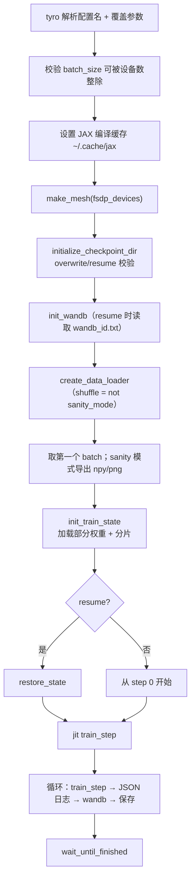

# 05 训练系统

训练系统负责：读取 `TrainConfig`、构建 LeRobot 数据管线、加载基座权重、初始化分布式训练状态、执行 Flow Matching + 子任务联合损失、记录日志与保存 Orbax Checkpoint。

涉及文件：

- [scripts/train.py](../../scripts/train.py) — 训练入口
- [src/openpi/training/config.py](../../src/openpi/training/config.py) — 配置定义
- [src/openpi/training/data_loader.py](../../src/openpi/training/data_loader.py)
- [src/openpi/training/optimizer.py](../../src/openpi/training/optimizer.py)
- [src/openpi/training/checkpoints.py](../../src/openpi/training/checkpoints.py)
- [src/openpi/training/weight_loaders.py](../../src/openpi/training/weight_loaders.py)
- [src/openpi/training/sharding.py](../../src/openpi/training/sharding.py)
- [src/openpi/training/utils.py](../../src/openpi/training/utils.py)

---

## 1. 配置模型

### 1.1 `DataConfig`

| 字段 | 默认 | 说明 |
| --- | --- | --- |
| `repo_id` | `None` | LeRobot 数据集 ID（相对 `$LEROBOT_HOME`） |
| `asset_id` | `None` | 归一化统计目录名 |
| `norm_stats` | `None` | 直接注入统计（通常由 `DataConfigFactory` 加载） |
| `repack_transforms` | 空 | 键名重映射 |
| `data_transforms` | 空 | 输入/输出数据变换 |
| `model_transforms` | 空 | 模型侧变换（tokenize/resize/pad） |
| `use_quantile_norm` | `False` | 是否使用 quantile 归一化 |
| `action_sequence_keys` | `("action",)` | 需要按 horizon 展开的动作列 |
| `prompt_from_task` | `False` | 由 LeRobot `task` 生成 prompt |
| `local_files_only` | `False` | 离线加载 |

`DataConfigFactory.create_base_config` 会在创建时加载 `assets/<asset_id>/norm_stats.json`；非 PI0 模型自动开启 quantile 归一化。

### 1.2 `TrainConfig`

| 字段 | 默认 | 说明 |
| --- | --- | --- |
| `name` | — | 配置名（`_CONFIGS` 的键） |
| `project_name` | `openpi_eval` | wandb 项目名 |
| `exp_name` | 必填 | 实验名（Checkpoint 子目录） |
| `model` | `Pi0Config()` | 模型配置 |
| `weight_loader` | `NoOpWeightLoader` | 基座权重加载策略 |
| `lr_schedule` | `CosineDecaySchedule()` | 学习率调度 |
| `optimizer` | `AdamW()` | 优化器 |
| `ema_decay` | `0.99` | EMA 衰减；`None` 关闭 |
| `data` | `FakeDataConfig()` | 数据配置工厂 |
| `assets_base_dir` | `./assets` | 归一化统计根目录 |
| `checkpoint_base_dir` | `./checkpoints` | Checkpoint 根目录 |
| `seed` | `42` | 随机种子 |
| `batch_size` | `32` | 全局 batch |
| `num_workers` | `64` | DataLoader worker |
| `num_train_steps` | `30000` | 训练步数 |
| `log_interval` | `10` | 日志间隔 |
| `save_interval` | `200` | 保存间隔 |
| `keep_period` | `1000` | 永久保留的 Checkpoint 周期 |
| `overwrite` / `resume` | `False` | 互斥 |
| `wandb_enabled` | `True` | 是否上报 wandb |
| `fsdp_devices` | `1` | FSDP 设备数 |
| `sanity_mode` | `False` | 固定 batch 调试模式 |
| `sanity_dump_dir` | `./sanity_dump` | sanity 输入导出目录 |

派生属性：

```text
assets_dirs    = <assets_base_dir>
checkpoint_dir = <checkpoint_base_dir>/<name>/<exp_name>
trainable_filter = nnx.All(nnx.Param, nnx.Not(freeze_filter))
```

### 1.3 四个 Zerith 配置

#### `pi0_zerith`

```yaml
model: Pi0Config(pi05=False, paligemma_variant=gemma_2b_lora,
                 action_expert_variant=gemma_300m, action_horizon=50)
data: hewu2008/clear_the_bin_box_20261010_v1  (asset 同名)
lr:   warmup=1000, peak=1e-5, decay=30000, end=1e-6
weight_loader: /data/4T-1/hewu/model_zoo/pi0_base_params/params
ema_decay: null
batch_size: 8, save_interval: 1000, num_train_steps: 30000
```

#### `pi05_zerith`

```yaml
model: Pi0Config(pi05=True, discrete_state_input=True,
                 paligemma_variant=gemma_2b_lora,
                 action_expert_variant=gemma_300m, action_horizon=50)
data: hewu2008/part_sorting_20261027_clean  (asset 同名)
lr:   warmup=1000, peak=2.5e-5, decay=60000, end=1e-6
weight_loader: /data/4T-1/hewu/model_zoo/pi05_base_params/params
ema_decay: 0.999
batch_size: 8, save_interval: 1000, num_train_steps: 60000
```

- `max_token_len` 自动变为 200；`use_quantile_norm=True`。
- pi0.5 基座无 LoRA 权重，`CheckpointWeightLoader` 用默认 `missing_regex=".*lora.*"` 从初始化模型回填。

#### `pi05_zerith_subtask`

```yaml
model: Pi0Config(pi05=True, discrete_state_input=True,
                 train_subtask_prediction=True, sample_subtask_prediction=True,
                 subtask_loss_weight=0.1, max_subtask_len=30,
                 paligemma_variant=gemma_2b_lora,
                 action_expert_variant=gemma_300m, action_horizon=50)
data: hewu2008/part_sorting_20261027_subtask
asset: hewu2008/part_sorting_20261027_clean
lr:   warmup=1000, peak=5e-5, decay=60000, end=1e-6
ema_decay: 0.999
batch_size: 16, save_interval: 2000, num_train_steps: 60000
```

- 训练 prompt 变为 `Task: …; Subtask: <label>; Action: `，并对子任务 token 施加 CE。
- 若数据集缺少 `meta/subtasks.jsonl`，所有帧子任务为空，CE 为 0，退化为普通 pi0.5。

#### `pi05_zerith_subtask_cls`

```yaml
model: Pi0Config(..., subtask_classification=True,
                 num_subtask_classes=13, subtask_class_loss_weight=0.2)
data: hewu2008/part_sorting_20261027_subtask
lr:   warmup=200, peak=1e-5, decay=16000, end=1e-6
optimizer: AdamWGroupedLR(head_lr_scale=100.0)
weight_loader: CheckpointWeightLoader(
    "openpi_checkpoints/pi05_zerith_subtask/"
    "part_sorting_20261027_subtask_60k_lr2.5e-5_bs8_ah50_pi05_lora/59999/params",
    missing_regex=".*lora.*|.*subtask_classifier.*")
ema_decay: 0.999
batch_size: 8, save_interval: 2000, num_train_steps: 16000
```

- 从 `pi05_zerith_subtask` 的 59999 步热启动。
- 分类头随机初始化，因此允许其缺失并用 100× 学习率快速收敛；token 级 CE 仍保留，服务端可回退到 generate。

---

## 2. train.py 启动流程



### 2.1 训练状态初始化

`init_train_state`：

1. 用 `jax.eval_shape` 建立 `TrainState` 形状；
2. `sharding.fsdp_sharding(...)` 生成参数分片；
3. `_load_weights_and_validate` 加载基座子集，校验形状/dtype；
4. 冻结参数转为 bf16；
5. `jax.jit(init)` 在分片下初始化；
6. 返回 `train_state` 与分片规格。

### 2.2 `train_step`

```python
action_loss, subtask_loss, subtask_class_loss = model.compute_loss_terms(...)
total = action_loss
if train_subtask_prediction:
    total += subtask_loss_weight * subtask_loss[:, None]
if subtask_classification:
    total += subtask_class_loss_weight * subtask_class_loss[:, None]
loss = mean(total)
```

- `nnx.DiffState(0, trainable_filter)`：只对可训练参数求梯度（冻结基座、保留 LoRA/action expert/分类头）。
- 梯度裁剪 1.0 → AdamW/AdamWGroupedLR 更新。
- EMA：`ema = decay * old + (1-decay) * new`。
- 日志字段：

| 字段 | 含义 |
| --- | --- |
| `loss` | 总损失 |
| `flow_loss` | Flow Matching MSE |
| `ce_loss` | 子任务 token CE |
| `cls_loss` | 子任务分类 CE |
| `grad_norm` | 梯度全局范数 |
| `param_norm` | 参数全局范数（仅核权重） |
| `lr` | 当前学习率 |

每步向 stdout 输出一行 JSON，同时写入 wandb（可关闭）。

### 2.3 保存策略

- 每 `save_interval` 步保存一次，并在最后一步强制保存。
- `max_to_keep=1`，`keep_period=config.keep_period` 的 Checkpoint 永久保留。
- 保存内容：`assets`（归一化统计）、`train_state`、`params`（推理用参数，含 EMA）。
- 异步保存（`AsyncOptions(timeout_secs=7200)`）。

---

## 3. 优化器

文件：[optimizer.py](../../src/openpi/training/optimizer.py)

| 配置 | 说明 |
| --- | --- |
| `CosineDecaySchedule` | 线性 warmup + cosine 衰减；`init = peak/(warmup+1)` |
| `RsqrtDecaySchedule` | 逆平方根衰减（可选） |
| `AdamW` | `b1=0.9, b2=0.95, eps=1e-8, wd=1e-10`，先 `clip_by_global_norm(1.0)` |
| `AdamWGroupedLR` | 按参数路径正则分组：`.*subtask_classifier.*` 使用 `lr × head_lr_scale`，其余使用原 lr；共享 warmup/cosine 形状 |

---

## 4. 数据加载

文件：[data_loader.py](../../src/openpi/training/data_loader.py)

### 4.1 `create_dataset`

```python
LeRobotDatasetMetadata(repo_id, local_files_only=True)
LeRobotDataset(
    repo_id,
    delta_timestamps={key: [t / fps for t in range(action_horizon)]
                      for key in action_sequence_keys},
    local_files_only=True,
)
```

- `delta_timestamps` 把每条样本展开为未来 `action_horizon` 步的动作。
- 可选预变换：
  - `PromptFromLeRobotTask(dataset_meta.tasks)`（`prompt_from_task=True`）；
  - `SubtaskFromIndex(load_subtasks(root))`（`train_subtask_prediction=True`）。
- **当前实现固定离线加载**（`local_files_only=True`），即使 `DataConfig.local_files_only=False`。

### 4.2 Transform 与 Batch

`transform_dataset` 依次应用：

```text
repack.inputs → data.inputs → Normalize → model.inputs
```

`TorchDataLoader`：

- PyTorch `DataLoader`，`drop_last=True`，`persistent_workers=True`；
- 多 worker 使用 `spawn`；
- collate 后把 JAX 数组放到指定 sharding；
- `DataLoaderImpl.__iter__` 产出 `(Observation, actions)`。

---

## 5. Checkpoint

文件：[checkpoints.py](../../src/openpi/training/checkpoints.py)

| 函数 | 作用 |
| --- | --- |
| `initialize_checkpoint_dir(dir, keep_period, overwrite, resume)` | 创建/校验目录；`max_to_keep=1`；resume 但无 Checkpoint 时自动取消 resume |
| `save_state(manager, state, data_loader, step)` | 保存 `assets`、`train_state`、`params`；assets 由回调写入 |
| `restore_state(manager, state, data_loader, step=None)` | 恢复训练状态 |
| `load_norm_stats(assets_dir, asset_id)` | 从 Checkpoint 的 `assets/<asset_id>` 读取统计 |
| `CallbackHandler` | 异步执行 assets 保存回调 |

Checkpoint 目录结构：

```text
<checkpoint_dir>/
├── assets/<asset_id>/norm_stats.json
├── params/                  # 推理用参数（含 EMA）
├── train_state/             # 优化器状态、step、EMA 参数
└── wandb_id.txt             # 用于 resume 同一 wandb run
```

> 部署时 `create_trained_policy` 只读取 `params/` 与 `assets/`，因此 Checkpoint 可独立拷贝到服务器。

---

## 6. 权重加载

文件：[weight_loaders.py](../../src/openpi/training/weight_loaders.py)

| 类 | 行为 |
| --- | --- |
| `NoOpWeightLoader` | 不加载，全部随机初始化 |
| `CheckpointWeightLoader(path, missing_regex=".*lora.*")` | 加载 PyTree 参数；与初始化参数严格校验结构；匹配 `missing_regex` 的缺失键用初始化值回填 |
| `PaliGemmaWeightLoader` | 加载 PaliGemma 权重，其余缺失（`missing_regex=".*"`）全部回填 |

典型用法：

- `pi0_zerith` / `pi05_zerith` / `pi05_zerith_subtask`：加载基座 `params`，LoRA 缺失项回填。
- `pi05_zerith_subtask_cls`：加载 59999 步权重，`missing_regex` 额外放行分类头。

`_merge_params` 会：

1. 只保留普通数组（去掉 `ShapeDtypeStruct`）；
2. 对缺失键检查是否匹配 `missing_regex`，不匹配则报错；
3. 用参考参数补齐缺失项。

---

## 7. 分片

文件：[sharding.py](../../src/openpi/training/sharding.py)

- `make_mesh(fsdp_devices)`：创建一维/二维 mesh（数据并行 + FSDP）。
- `fsdp_sharding(train_state_shape, mesh, log=True)`：为参数生成 FSDP 分片规格。
- `set_mesh(mesh)`：训练循环内切换当前 mesh。
- 数据 batch 使用 `PartitionSpec(DATA_AXIS)`，`train_step` 的 `in_shardings/out_shardings` 显式声明。

单卡时 `fsdp_devices=1`，等价于纯数据并行。

---

## 8. sanity 模式

`sanity_mode=True` 时：

- 数据加载器 `shuffle=False`，训练循环**始终复用同一个 batch**；
- 启动时把反归一化后的 `state/actions/raw_state/raw_actions` 保存为 `.npy`，图像保存为 `.png` 到 `sanity_dump_dir`；
- 用于验证前向/反向可复现、检查数据是否异常，不用于正式训练。

```bash
uv run scripts/train.py pi05_zerith --exp_name sanity --sanity_mode --sanity_dump_dir ./sanity_dump
uv run scripts/inspect_sanity_dump.py --dump_dir ./sanity_dump
```

---

## 9. CLI

```bash
uv run scripts/train.py <config_name> \
  --exp_name <name> \
  [--overwrite | --resume] \
  [--batch_size 8] \
  [--num_train_steps 60000] \
  [--num_workers 64] \
  [--fsdp_devices 1] \
  [--no-wandb_enabled] \
  [--sanity_mode]
```

常用组合：

```bash
# 从基座开始
uv run scripts/train.py pi0_zerith --exp_name pi0_run --overwrite

# pi0.5 + 子任务分类
uv run scripts/train.py pi05_zerith_subtask_cls --exp_name cls_run --overwrite

# 断点续训
uv run scripts/train.py pi05_zerith --exp_name pi05_run --resume
```

> `--overwrite` 与 `--resume` 互斥；`exp_name` 缺失时 `checkpoint_dir` 会直接报错。

---

下一步：[06 策略服务与客户端](./06-serving-and-client.md)
