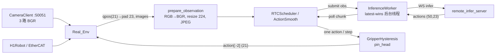

# 07 机器人运行时

机器人运行时位于 [robot_infer/](../../robot_infer/)，运行在 Zerith H1 Pro 自带的 `zerith` 环境中，**不依赖 JAX/CUDA**，只通过 WebSocket 请求远程策略。它的目标是：在 30Hz 控制周期内稳定消费动作块，并处理真实硬件的抖动、延迟与安全回退。

涉及文件：

- [robot_infer/scripts/test_pi0.py](../../robot_infer/scripts/test_pi0.py) — 主控制循环
- [robot_infer/utils/real_env_sdk.py](../../robot_infer/utils/real_env_sdk.py) — 环境与 SDK 封装
- [robot_infer/utils/async_infer.py](../../robot_infer/utils/async_infer.py) — 后台推理线程
- [robot_infer/utils/rtc_client.py](../../robot_infer/utils/rtc_client.py) — RTC 客户端调度
- [robot_infer/utils/subtask_home_guard.py](../../robot_infer/utils/subtask_home_guard.py) — Home 守卫
- [robot_infer/lib/](../../robot_infer/lib/) — SDK 1.3.4 绑定与 proto

---

## 1. 运行时组件关系



### 线程模型

| 线程 | 职责 |
| --- | --- |
| 主线程 | 30Hz 控制循环、动作后处理、SDK 下发 |
| `InferenceWorker` | 阻塞式 WebSocket `infer`，不阻塞控制循环 |
| CameraClient 采集线程 | 每路相机一个 daemon 线程，持续写入最新帧 |
| WebSocket 服务端 | 独立进程（GPU 工作站） |

`InferenceWorker` 采用 **latest-wins** 槽位：新观测覆盖尚未被取走的旧观测，天然形成背压，避免请求堆积。

---

## 2. 启动流程

`main(args)` 的顺序：

```text
1. make_real_env(camera_names)           # 连接机器人、切换重力补偿模式、robot_init
2. env.move_to_init_pose()               # 2s 插值到全零姿态（保留腰部高度）
3. WebsocketClientPolicy(host, port)     # 连接并读取 metadata
4. 若 --rtc：validate_server_metadata    # 必须存在 rtc.version==1
5. observation = env.reset().observation；state=qpos
6. warm_up(...)                          # 默认 10 次空 prompt 推理
7. 创建 InferenceWorker；RTC 模式创建 RTCScheduler，否则 ActionSmooth
8. worker.start()
9. 若 --init_hdf5：加载首帧动作，move_to_target_joint(action[:-2])
10. 若 home_recovery：装载 HomeSubtaskGuard
11. pdb.set_trace()                      # 人工确认场地后再开始
12. 同步等待第一个动作块（30s 超时）
13. run_rtc_loop(control_step, 30Hz, num_steps)
14. 退出：保存动作、停止 worker、打印推理统计
```

> `test_pi0.py` 启动时会执行 `sudo rm -rf /dev/shm/zcm`，这是 Zerith 相机/共享内存的历史清理步骤。

---

## 3. CLI 参数

| 参数 | 默认 | 说明 |
| --- | --- | --- |
| `--host` | `127.0.0.1` | 策略服务器地址 |
| `--port` | `55555` | 策略服务器端口 |
| `--prompt` | `grab all the ducks and put them into the basket` | 语言指令 |
| `--num_steps` | `20000` | 控制步数（约 11 分钟 @30Hz） |
| `--warmup_steps` | `10` | 预热推理次数 |
| `--save_actions` | 空 | 保存每步动作到 `.npy` |
| `--control_freq` | `30.0` | 控制频率 Hz |
| `--query_frequency` | `15` | 非 RTC 模式每 N 步查询一次 |
| `--watchdog_timeout` | `2.0` | 推理停滞告警阈值（秒） |
| `--init_hdf5` | **必填** | 初始化姿态参考 HDF5 |
| `--init_frame_idx` | `0` | 参考帧 |
| `--no_pin_head` | — | 关闭头部关节锁定 |
| `--rtc` / `--no-rtc` | `True` | 启用 RTC（默认） |
| `--s_min` | `15` | RTC 最小执行步数 |
| `--subtask.mode` | `classifier` | `classifier` / `generate` / `off` |
| `--subtask.jsonl` | `None` | 子任务类别表（用于解析 home 文本） |
| `--home_consecutive` | `3` | 连续多少次 home 预测触发回位 |
| `--home_recovery` / `--no_home_recovery` | `True` | 是否启用 Home 回位 |
| `--camera_names` | 三路相机 | 相机名列表 |

---

## 4. 观测构造

### 4.1 `Real_Env`

文件：[real_env_sdk.py](../../robot_infer/utils/real_env_sdk.py)

| 成员 | 说明 |
| --- | --- |
| `H1Robot` | Zerith SDK 机器人句柄 |
| `CameraClient(grpc_target="localhost:50051")` | 相机服务，`get_latest_frame` 返回 BGR 帧 |
| `ImageRecorder` | 为每路相机开线程，维护 `image_dict` 最新帧 |
| `arm_motor_index` | 左臂 8 + 右臂 8（第 8 个为夹爪） |
| `waist_motor_index` | `MOTOR_LIFT`、`MOTOR_WAIST_DOWN`、`MOTOR_WAIST_UP` |
| `head_motor_index` | `MOTOR_HEAD_DOWN`、`MOTOR_HEAD_UP` |
| `motor_num` | 21 |

主要方法：

| 方法 | 行为 |
| --- | --- |
| `get_observation()` | 返回 `dm_env.TimeStep`；`qpos` 为 21 维，末尾补 2 个 0 得到 23 维；`images` 经别名归一化 |
| `get_joint_position()` | 读取 21 个电机 `Position_Actual` |
| `_set_joint_action(action)` | 断言长度 21，逐电机 `setMotorControl_low` |
| `move_to_init_pose()` | 2s/1000 步插值到全零姿态，**保留腰部高度电机（index 16）** |
| `move_to_target_joint(action)` | 2s/1000 步插值到目标 21 维姿态 |
| `get_robot_is_normal()` | 检查右臂目标位置速度/静止范围（安全接口，主循环未强制使用） |
| `send_motor(idx, pos/speed/torque)` | 底层电机命令，兼容不同 SDK 绑定签名 |
| `get_state(idx)` | 兼容多种 `getMotorState` 绑定形式 |

相机名兼容：`cam_high`、`rs/cam_high`、`rs.cam_high`、`rs_cam_high`、`images["rs"]["cam_high"]`。

### 4.2 `prepare_observation`

```python
observation["state"] = observation["qpos"]        # 23 维
observation["prompt"] = prompt
for cam in camera_names:
    image = get_camera_image(observation["images"], cam)
    observation["images"][cam] = compress_image(
        resize_with_pad(cv2.cvtColor(image, cv2.COLOR_RGB2BGR), 224, 224)
    )
```

- `compress_image`：JPEG quality 100，返回 uint8 ndarray（由 msgpack-numpy 作为 ndarray 发送）。
- `state` 与 `qpos` 同时发送；服务端使用 `state`，`qpos` 仅用于机器人端本地逻辑。
- 首次同步等待第一块动作，避免用空动作驱动电机。

---

## 5. 非 RTC 模式：`ActionSmooth`

当 `--no-rtc` 时使用时间集成（temporal ensembling）：

```text
all_time_actions[t, t : t+H] = 新动作块
action_t = Σ_i exp(-0.01·i)·all_time_actions[i, t] / Σ exp(-0.01·i)
```

| 特性 | 说明 |
| --- | --- |
| 查询频率 | 每 `query_frequency=15` 步一次 |
| 平滑系数 | `k = 0.01`，越新的块权重越大 |
| 不平滑通道 | 19、20（头）、21、22（底盘），直接取最新块 |
| 夹爪 | 7、15 参与平滑 |
| 内存 | `O(T²)`，`T = num_steps`（2 万步时约 1.5GB，需注意） |
| `reset()` | Home 回位前后清空，防止把旧阶段的动作混入新阶段 |

`_consume_results` 会丢弃 `query_t > t` 的过期结果，避免控制步回退。

---

## 6. RTC 模式：`RTCScheduler`

RTC 模式**完全替代** `ActionSmooth`（按论文的基线对比，不叠加时间集成）。实现仅依赖 numpy，可运行在机器人环境。

### 6.1 协议

```python
obs["rtc"] = {
    "version": 1,
    "prev_chunk_left_over": np.float32[T_prev, 23],  # 原始（未经回滞/pin）的剩余动作
    "inference_delay": d,                            # 实测延迟（控制步）
    "execution_horizon": s,                          # max(d, s_min, H - T_prev)
}
```

- 首个块没有 leftover → **不带** `rtc` 字段，走普通路径。
- `validate_server_metadata` 要求服务端 metadata 含 `rtc.version == 1`，否则拒绝启动。

### 6.2 调度算法

每个控制步 `get_action(observation)`：

1. **消费结果**：`worker.poll()` 拿到 `(query_t, actions)`，调用 `observe_chunk`；
2. `real_delay = t - query_t`；若 `query_t <= last_merged_query_t`（乱序）或延迟 `> H`（过期）则丢弃；
3. `queue.merge(...)`：RTC 模式**替换**队列并跳过前 `real_delay` 个动作（这些步在推理期间已经过去）；
4. `LatencyTracker.add(real_delay)`；`steps_since_swap = real_delay`；
5. **触发提交**：`queue.empty()` 或 `steps_since_swap >= s_min`，且 worker 空闲时提交；
6. 从队列取一个动作返回；队列空则返回 `None`（主循环保持当前姿态）。

### 6.3 引导权重

客户端 `rtc_weights_np` 与服务端 `rtc.rtc_weights` 使用同一闭式公式：

```text
s = max(d, s_min, H - T_prev)
W_i = 1                                   (i < d)
W_i = c_i·expm1(c_i)/(e-1)               (d ≤ i < H-s)
W_i = 0                                   (i ≥ H-s)
c_i = (H - s - i) / (H - s - d + 1)
另外 i ≥ T_prev 的位置置 0（短 leftover 的补零区）
```

`robot_infer/tests/test_rtc_client.py` 对客户端与服务端公式做交叉测试，防止漂移。

### 6.4 延迟与队列

| 组件 | 行为 |
| --- | --- |
| `LatencyTracker(maxlen=20)` | 滑动窗口最大值作为 `d`；窗口内一个尖峰离开后不再主导 |
| `NumpyActionQueue` | 双轨：`queue` 给机器人、`original_queue` 提供 leftover；RTC 模式 O(H) 内存 |
| `get_left_over()` | 返回未消费的原始动作后缀，作为下一次 RTC 的 `prev_chunk_left_over` |
| `reset()` | 清空队列、延迟窗口、计数器（Home 回位后调用） |
| `worker.drain()` | 丢弃已完成但未消费的块，用于阻塞阶段前后 |

### 6.5 延迟会计

- 延迟以 **控制步** 计，而非墙钟估计；
- `steps_since_swap` 在合并时重置为 `real_delay`，对应论文 `t = t - s`；
- 提交时记录 `(t, action_index)`，合并时校验实际消费差与测得延迟是否一致，不一致仅告警。

---

## 7. 动作后处理

### 7.1 夹爪回滞 `GripperHysteresis`

| 参数 | 左夹爪（7） | 右夹爪（15） |
| --- | --- | --- |
| `close` | 0.45 | 0.45 |
| `open` | 0.20 | 0.20 |
| 去抖步数 | 1 / 1 | 1 / 1 |
| 闭合值 | 1.3 | 1.3 |

逻辑：

- 未闭合：动作 > `close` 连续 N 步 → 置为 `closed_value (1.3)`；
- 已闭合：动作 < `open` 连续 N 步 → 重新打开，否则保持闭合值。

用于抑制夹爪在阈值附近抖动。

### 7.2 头部锁定 `pin_head_action`

```python
action[-4:-2] = data_action[-4:-2]   # 23 维中的索引 19、20
```

把头部 yaw/pitch 固定为 `--init_hdf5` 首帧的姿态，避免策略输出导致相机视角漂移。

### 7.3 下发给机器人

```python
env._set_joint_action(action[:-2])   # 23 → 21，丢弃底盘 2 维
```

23 维布局：`0-6` 左臂、`7` 左夹爪、`8-14` 右臂、`15` 右夹爪、`16-18` 腰、`19-20` 头、`21-22` 底盘。

---

## 8. Home 守卫

文件：[subtask_home_guard.py](../../robot_infer/utils/subtask_home_guard.py)

- 内置 home 文本：`"move both arms back to the home position"`；
- 也可从 `--subtask.jsonl` 的 `subtask_index == 0` 读取；
- 文本归一化：`strip().rstrip(";,. ").strip().lower()`（去掉生成模板尾部的 `;`）；
- 用 `(text, seq)` 去重，**按动作块计数**而不是按控制步；
- 连续 `home_consecutive` 个块预测 home → 触发一次回位，并**加锁**；
- 只有出现不同的子任务才重新解锁，避免机器人停在 home 时反复回位。

触发后的动作：

```text
worker.drain()                     # 丢弃旧阶段的块
env.move_to_target_joint(home_pose)  # home_pose = init_hdf5 首帧 action[:-2]
worker.drain()
scheduler.reset() / action_smooth.reset()
```

`HOME_SUBTASK` 同时被 `open_loop_eval.py` 使用，保证评估与部署的文本一致。

---

## 9. 控制循环

```python
def control_step(step):
    # 1) 子任务日志 / Home 守卫
    subtask, seq = worker.latest_subtask()
    if home_guard.observe(subtask, seq):
        ... 回位并 reset，return True（重置调度截止时间）

    # 2) 采集 + 编码
    observation = env.get_observation().observation
    observation["state"] = observation["qpos"]
    observation = prepare_observation(...)

    # 3) 取动作（RTC 或 ActionSmooth）
    action = scheduler.get_action(observation) or action_smooth.get_action(observation)

    # 4) 无动作 → 保持当前姿态
    if action is None:
        env._set_joint_action(observation["qpos"][:-2]); return

    # 5) 后处理 + 下发
    gripper.apply(action)
    pin_head_action(action, data_action)
    env._set_joint_action(action[:-2])

    # 6) 看门狗
    if worker.last_result_age() > watchdog_timeout: log error
```

`run_rtc_loop` 使用**绝对截止时间**调度：

- 每步 `sleep` 到下一个截止时间；
- 若某步超时，记录 `Control loop overrun: x ms late`；
- 阻塞阶段（Home 回位）返回 `True`，循环重置截止时间，避免补跑积压步。

---

## 10. 安全与运维建议

| 风险 | 建议 |
| --- | --- |
| 首块未到就驱动电机 | 代码已同步等待第一块（30s）；不要绕过 |
| 推理卡死 | 看门狗 2s 告警；建议人工急停 + 降低查询频率 |
| RTC 服务端不兼容 | 启动时握手会直接报错；不要关闭校验 |
| 动作跳变 | RTC 模式不要叠加 ActionSmooth；Home 回位后必须 `reset()` |
| 夹爪抖动 | 调整 `GripperHysteresis` 阈值/去抖步数 |
| 相机别名不一致 | 使用 `camera_aliases` 或直接检查 `images["rs"]` |
| 机器人未连接 | `Real_Env` 最多重试 10 次，每次 1s；失败后检查 EtherCAT/电源 |
| 腰部高度被归零 | `move_to_init_pose` 已保留 index 16；自定义回位时注意 |
| SDK 版本不符 | `robot_infer/lib` 为 1.3.4 绑定，升级 SDK 需同步更新 `.so/.pyi` |

---

## 11. 运行示例

```bash
# 机器人端（在 robot_infer 目录下）
python scripts/test_pi0.py \
  --host 192.168.1.100 --port 55555 \
  --prompt "Sort all objects into the correct bins using both arms" \
  --init_hdf5 /data/demos/episode_0000.hdf5 \
  --init_frame_idx 0 \
  --subtask.mode classifier \
  --subtask.jsonl assets/subtasks.jsonl \
  --num_steps 9000 \
  --rtc --s_min 15 \
  --control_freq 30 \
  --save_actions /tmp/actions.npy
```

```bash
# 关闭 RTC，使用 ActionSmooth
python scripts/test_pi0.py --no-rtc --query_frequency 15 ...
```

---

下一步：[08 脚本与工具](./08-scripts-and-tools.md)
