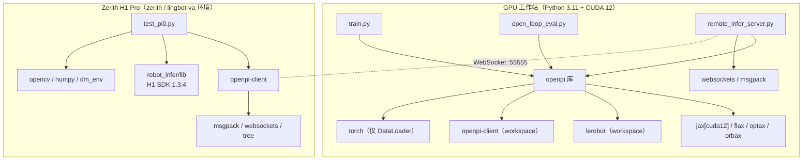
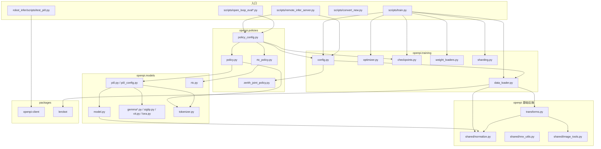

# 09 依赖关系

## 1. 运行时拓扑依赖



---

## 2. 模块依赖图（仓库内部）



### 关键依赖边

| 从 | 到 | 说明 |
| --- | --- | --- |
| `training.config` | `policies.zerith_joint_policy` | 构造 Zerith 的输入/输出 Transform |
| `training.config` | `training.data_loader` | `create_base_config` 需要 dataset 类型 |
| `training.data_loader` | `transforms`、`shared.normalize`、`lerobot` | 数据变换与统计注入 |
| `policies.policy_config` | `training.config`、`policies.policy`、`policies.rtc_policy`、`training.checkpoints` | 从 Checkpoint 组装策略 |
| `policies.policy` | `models.pi0`、`models.tokenizer` | 采样与子任务 tokenizer |
| `models.pi0` | `models.model`、`models.gemma*`、`models.siglip`、`models.lora`、`models.rtc` | 网络与引导 |
| `scripts.remote_infer_server` | `policies.policy_config`、`training.config` | 服务入口 |
| `robot_infer` | `openpi_client` | **不依赖 openpi**，机器人端无需 JAX |

> `training/config.py` 会导入 `policies.zerith_joint_policy`，而 `policies/policy_config.py` 又导入 `training.config`。Python 通过**函数内延迟导入**（如 `from openpi.training import config as _config` 放在函数体中）避免模块级循环依赖；修改导入结构时需保持这一点。

---

## 3. 第三方依赖

### 3.1 根项目（`pyproject.toml`）

| 领域 | 依赖 | 用途 |
| --- | --- | --- |
| Python | `>=3.11,<3.12` | 训练与服务环境 |
| 深度学习 | `jax[cuda12]==0.5.3`、`flax==0.10.2`、`optax`、`orbax-checkpoint==0.11.3` | 模型、训练、Checkpoint |
| 数值 | `numpy<2.0`、`jaxtyping==0.2.36`、`einops`、`ml_collections`、`beartype==0.19.0` | 类型与数组 |
| 数据 | `lerobot`（workspace）、`datasets==3.6`、`polars`、`pyarrow`（间接） | LeRobot 数据集 |
| 框架 | `torch==2.7.1` | 仅用于 `TorchDataLoader` |
| 模型加载 | `transformers==4.53.2`、`sentencepiece`、`safetensors`（间接） | SigLIP/Gemma 权重与 tokenizer |
| 图像 | `opencv-python-headless`、`pillow`、`imageio` | 图像编解码 |
| 服务 | `websockets`、`msgpack`（经 openpi-client） | WebSocket 推理 |
| 配置/CLI | `tyro>=0.9.5`、`rich` | 训练参数解析 |
| 实验 | `wandb>=0.19.1` | 指标上报 |
| 存储 | `fsspec[gcs]`、`boto3`、`filelock` | 远端 Checkpoint / 下载 |
| 其他 | `augmax`、`dm-tree`、`flatbuffers`、`gym-aloha`、`tqdm-loggable`、`treescope`、`numpydantic` | 上游 OpenPI 依赖 |

约束：

```toml
[tool.uv]
override-dependencies = ["ml-dtypes==0.4.1", "tensorstore==0.1.74"]
```

这是 JAX 0.5.3 的兼容性锁定，升级 JAX 时需同步调整。

### 3.2 `openpi-client`（轻量、可独立安装）

| 依赖 | 用途 |
| --- | --- |
| `numpy<2.0` | 数组 |
| `msgpack>=1.0.5` | 线协议 |
| `websockets>=11.0` | 客户端 |
| `dm-tree` / `tree` | 嵌套结构切片（ActionChunkBroker） |
| `pillow` | 图像工具 |

`requires-python >=3.7`，因此机器人环境（可能不是 3.11）也能安装。

### 3.3 `lerobot`

- 以 workspace 形式**随仓库锁定**，避免上游 API 漂移；
- 提供 `LeRobotDataset`、`LeRobotDatasetMetadata`、`AsyncImageWriter`、`encode_numpy` 等；
- 需要 `torch`、`datasets`、`pyarrow`、`imageio[ffmpeg]`、`wandb` 等。

---

## 4. 隐式/按场景依赖

这些包未在根 `pyproject.toml` 中显式声明，但脚本/运行时会用到：

| 包 | 使用位置 | 说明 |
| --- | --- | --- |
| `h5py` | `convert_new.py`、`test_pi0.py`、`open_loop_eval` | 读取 HDF5；通常由 lerobot/conda 环境带入 |
| `matplotlib` | `open_loop_eval*.py`、`visualize_norm_stats.py` | dev 依赖组；评估环境需安装 |
| `opencv-python` | `test_pi0.py`、`open_loop_eval_remote.py` | 机器人端与远程评估 |
| `dm_env` | `real_env_sdk.py` | 返回 `TimeStep` |
| `pyarrow` | `merge_bin_box_datasets.py` | 直接读写 parquet |
| `websockets` | 机器人端 | `websockets.sync.client` |
| `hf` / `huggingface_hub` | `run_download_robotwin2.sh` | 数据集下载 |

> 如果 `convert_new.py` 报 `ModuleNotFoundError: h5py`，在 GPU 环境执行 `uv pip install h5py`。

---

## 5. 配置/资产/Checkpoint 的依赖链

```text
config.py
 ├─ DataConfig.repo_id ─────────► $LEROBOT_HOME/<repo_id>（数据集）
 ├─ DataConfig.asset_id ────────► assets/<asset_id>/norm_stats.json
 ├─ TrainConfig.checkpoint_dir ─► openpi_checkpoints/<name>/<exp_name>/
 └─ model.pi05 / subtask flags ─► Checkpoint 结构、token 布局、服务端行为

Checkpoint
 ├─ params/ ────────────────────► create_trained_policy 加载
 ├─ assets/<asset_id>/norm_stats.json ─► 推理归一化（必须与训练一致）
 └─ train_state/ ───────────────► 仅 resume 训练
```

**必须保持一致的三元组**：

1. `repo_id`（数据）↔ `asset_id`（统计）↔ 训练配置；
2. `norm_stats.json`（训练）↔ Checkpoint 内 assets（推理）；
3. `subtasks.jsonl`（训练 meta）↔ 服务端 `--subtask.jsonl` ↔ 机器人端 `--subtask.jsonl`。

---

## 6. 环境隔离

| 环境 | 需要安装 | 不需要 |
| --- | --- | --- |
| GPU 训练/服务 | 根项目全部依赖 + CUDA 12 | 机器人 SDK |
| 机器人端 | `openpi-client`、`numpy`、`opencv`、`dm_env`、`h5py`、SDK 1.3.4 | JAX、Flax、torch、lerobot |
| 数据准备 | `lerobot`、`datasets`、`h5py`、`opencv`、`pyarrow` | GPU |

> 机器人端只需拷贝 `robot_infer/` 与安装 `packages/openpi-client`，这大幅降低部署复杂度。

---

## 7. 版本锁定与升级注意事项

| 组件 | 锁定值 | 升级风险 |
| --- | --- | --- |
| `jax[cuda12]` | 0.5.3 | NNX / `jax.tree` API 变化会影响模型与训练 |
| `flax` | 0.10.2 | NNX `Module`、`nnx_bridge` 行为 |
| `orbax-checkpoint` | 0.11.3 | Checkpoint 格式与异步保存 |
| `ml-dtypes` / `tensorstore` | 0.4.1 / 0.1.74 | JAX 运行时兼容 |
| `torch` | 2.7.1 | DataLoader 与 lerobot |
| `numpy` | `<2.0` | `msgpack-numpy`、lerobot 兼容 |
| `transformers` | 4.53.2 | PaliGemma 权重加载 |
| Zerith SDK | 1.3.4（`robot_infer/lib`） | 电机枚举、`getMotorState` 签名变化 |

---

下一步：[10 运行与排障](./10-running.md)
